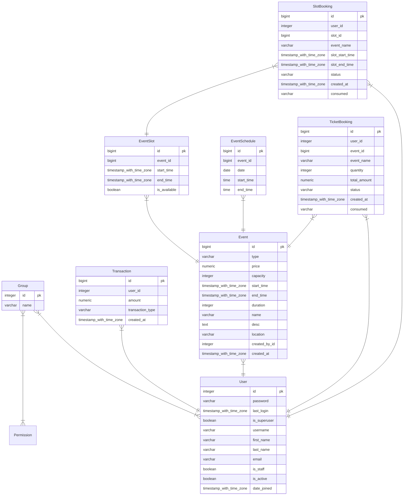

# Plaza — A lifestyle and Going-Out App

Plaza is a full-stack web application inspired by platforms like District by Zomato. It allows users to discover and book ticket-based events (concerts, movies) and slot-based activities (turfs, basketball courts, pool tables), manage an in-app wallet balance, and track booking history. 

It also features a dedicated **Organization Dashboard** where event creators can manage listings, track check-ins by marking tickets as consumed, and analyze revenue statistics

---

## Key Features

### User Flow
* **Authentication**: Group based authentication implemented to distinguish between organization users and regular users.
* **In-App Wallet**: Mock payment flow allowing users to credit funds with timestamped transaction logs.
* **Event Discovery & Booking**:
  * **Ticket-Based Events**: Such asconcerts, movies, and shows.
  * **Slot-Based Events**: Select specific date and time slots for venues, courts, and sports fields.
* **User Dashboard**:
  * View upcoming active tickets and slot reservations.
  * View all past bookings 
  * Timestamped wallet transaction history.

###  Organization Management
* **Event Management**: Create and manage ticketed events or slot-based activities with custom fields like price, location, capacity, start/end dates.
* **Ticket Verification**: View all attendee bookings with unique IDs and mark tickets as `consumed`.
* **Analytics Panel**: 
  * Total Revenues
  * Ticket Consumption Ratio (Consumed vs. Total Booked)


##  Tech Stack

* **Backend**: Python 3.14.4 Django
* **Database**: PostgreSQL
* **Frontend**: Bootstrap

---

## Database Models & Architecture

The database design is created so as to ensure complete ACID Compliance and secure authentication.


## Getting Started & Installation Guide
### Prerequisites
Make sure you have the following installed on your system:
* **Python** (version 3.14 or higher)
* **PostgreSQL** 
* **uv**

### Clone the Repository
```bash
git clone https://github.com/Vihaan192/plaza
cd plaza
```

### Create & Activate a Virtual Environment
Using `uv`:
```bash
uv venv
source .venv/bin/activate
```

### Installation of required packages
```bash
uv pip install -r requirements.txt
```

### Configure Environment Variables
Create a local .env file in the root directory of the project clone to store credentials.

```bash
nano .env
```
Open .env and add your configuration (matching your PostgreSQL setup):
```bash
DEBUG=True
SECRET_KEY=your_django_secret_key_here

DB_NAME=plaza_db
DB_USER=your_postgresql_user
DB_PASSWORD=your_postgresql_password
DB_HOST=localhost
DB_PORT=5432
```
### Run Database Migrations
Initialize your PostgreSQL database structure by running Django's migrations:

```bash
python manage.py makemigrations
python manage.py migrate
``` 

### Create a Superuser & Configure Roles
To access the admin panel and create organizations:

```bash
python manage.py createsuperuser
```

Start the server (python manage.py runserver) and head to http://localhost:8000/admin/.

Create two user Groups inside the admin dashboard:

Normal
Organization

Assign user accounts to their respective groups depending on whether they are regular customers or organization event managers.

### Run the Development Server

```bash
python manage.py runserver
```
